# FermFrame user manual

*For FermFrame app 1.0.1 and FermFrame firmware 2.2. The pictures use made-up FermFrames ("Garage fridge",
"Brew closet" and "Kitchen") – yours will show your own names and brews.*

*Prefer watching? There's a 3-minute [video guide on YouTube](https://youtu.be/npmeVGuBcoU).*

---

## Contents

1. [What FermFrame is](#1-what-fermframe-is)
2. [What you need](#2-what-you-need)
3. [Getting a clock](#3-getting-a-clock)
4. [Installing the app](#4-installing-the-app)
5. [Getting your Brewfather or RAPT details](#5-getting-your-brewfather-or-rapt-details)
6. [Setting up a new FermFrame](#6-setting-up-a-new-fermframe)
7. [The main window](#7-the-main-window)
8. [Looking after several FermFrames](#8-looking-after-several-fermframes)
9. [Settings](#9-settings)
10. [Firmware updates](#10-firmware-updates)
11. [What the FermFrame shows](#11-what-the-fermframe-shows)
12. [The FermFrame's own settings page](#12-the-fermframes-own-settings-page)
13. [Troubleshooting](#13-troubleshooting)
14. [Questions and answers](#14-questions-and-answers)
15. [Privacy and security](#15-privacy-and-security)
16. [Updating and removing the app](#16-updating-and-removing-the-app)
17. [Getting help](#17-getting-help)

---

## 1. What FermFrame is

A **FermFrame** is a small desk clock with a colour screen that has been turned into a fermentation display.
It shows your current brew's **gravity**, **temperature**, **ABV**, how many days it has been fermenting and a
**graph** of the whole fermentation, straight from **Brewfather** or a **RAPT Pill**.

Once it's set up, a FermFrame works on its own: it joins your home Wi-Fi, asks Brewfather or RAPT for new
readings every few minutes and updates its screen. **No computer, phone or hub has to stay on.**

The **FermFrame app** for Windows is what you use to:

- turn a brand-new clock into a FermFrame (over Wi-Fi – no cables)
- see all your FermFrames, their brews and graphs in one place
- change how each FermFrame looks and behaves
- keep the FermFrame software (its *firmware*) up to date

FermFrame is free and open source. It isn't made by or connected with GeekMagic, Brewfather or KegLand (RAPT).

---

## 2. What you need

| You need | Notes |
|---|---|
| **A "Smart Weather Desktop Clock"** | The small cube with a square colour screen, also sold as **GeekMagic SmallTV** or **SmallTV-Ultra**. It must have the **ESP8266** chip – see [section 3](#3-getting-a-clock). |
| **A USB power supply** for the clock | Any phone charger. The clock is never plugged into the PC. |
| **A Windows 10 or 11 PC with Wi-Fi** | Only needed for setting up and for changing settings. A laptop is ideal. A desktop PC without Wi-Fi can still view and change FermFrames, but can't set up new ones. |
| **2.4 GHz Wi-Fi at home** | Almost every router has it. The clock can't use 5 GHz-only networks. |
| **Brewfather** (with an API key) **or RAPT** (with an API secret) | See [section 5](#5-getting-your-brewfather-or-rapt-details). Brewfather's API needs a Premium account. |

---

## 3. Getting a clock

In the app, click **Buy another FermFrame** (bottom left). It shows exactly which clock to buy and links to shops,
with the listing FermFrame was tested on first.

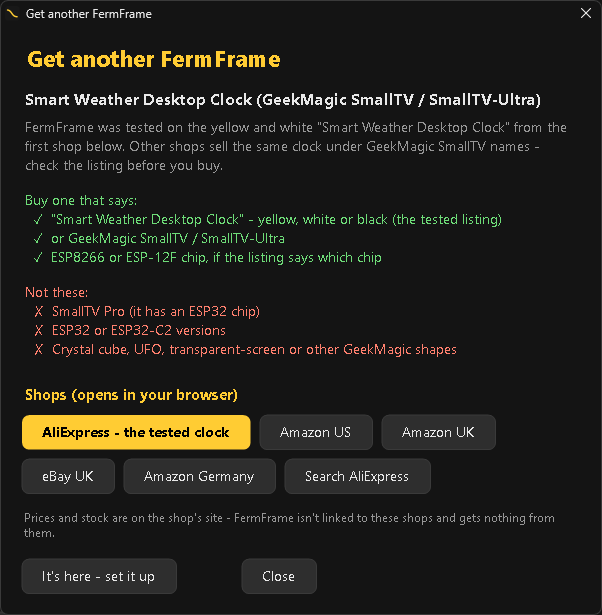

**Buy one that says:**

- *Smart Weather Desktop Clock* (sold in yellow, white or black), **or**
- *GeekMagic SmallTV* or *SmallTV-Ultra*
- *ESP8266* or *ESP-12F*, if the listing says which chip

**Don't buy:**

- the **SmallTV Pro** – it has an ESP32 chip and FermFrame doesn't run on it
- anything described as ESP32 or ESP32-C2
- GeekMagic's other shapes (crystal cube, UFO, transparent screen)

When your clock arrives, click **It's here – set it up** to go straight to [setting it up](#6-setting-up-a-new-fermframe).

---

## 4. Installing the app

1. Download **`FermFrame-<version>.exe`** from the
   [Releases page](https://github.com/ammcknockiter-cyber/FermFrame/releases/latest).
2. Open it. Windows may show **"Windows protected your PC"**. This appears for apps that aren't signed by a
   company – click **More info**, then **Run anyway**.
3. The FermFrame installer opens:

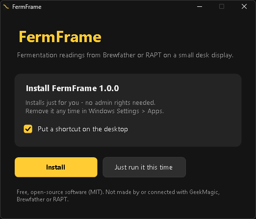

4. Leave **Put a shortcut on the desktop** ticked if you want one, and click **Install**.
   FermFrame opens straight away.

**Good to know**

- It installs **just for you** and needs **no administrator rights**. The app goes in
  `%LOCALAPPDATA%\Programs\FermFrame` and appears in the **Start menu**.
- **Just run it this time** opens the app without installing anything – handy on someone else's PC.
- The download is a single file. You can delete it after installing.
- To check your download, compare its SHA-256 checksum with the one in the release notes
  (in PowerShell: `Get-FileHash .\FermFrame-1.0.0.exe`).

---

## 5. Getting your Brewfather or RAPT details

FermFrame reads your readings straight from Brewfather or RAPT, so each FermFrame needs your account details.

### Brewfather

1. Open Brewfather and go to **Settings → API**.
2. Click **Generate API key** and tick **Read batches**.
3. Copy the **User ID** and the **API key** (the key is shown only once – keep it somewhere safe).

> **One key for all your FermFrames.** Brewfather allows one API key per account. Use the same User ID and key
> on every FermFrame. If you ever generate a new key, every FermFrame stops getting readings until you put the
> new key into each one (Settings tab → **Brewfather API key** → Save).

FermFrame shows batches whose status is **Fermenting**. Set your batch to Fermenting in Brewfather and it
appears within one refresh (5 minutes by default).

### RAPT Pill

1. Sign in on the RAPT website and go to **My account → API Secrets → Create**.
2. Use your **RAPT email** and the **API secret** – not your RAPT password.

---

## 6. Setting up a new FermFrame

Setting up takes about **three minutes**. The PC talks to the clock over Wi-Fi, so keep the clock within Wi-Fi range
of the PC.

1. **Plug the clock into power** and wait about 30 seconds. A brand-new clock shows its weather screen.
2. In the app, click **+ Set up a new FermFrame**.

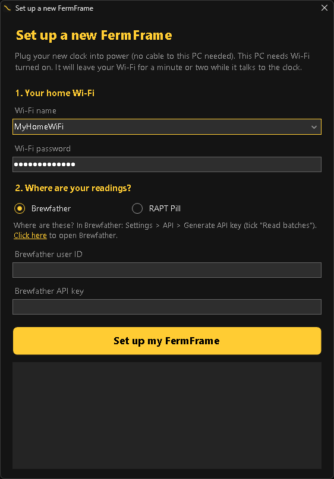

3. **Your home Wi-Fi.** The app fills in the Wi-Fi this PC is using and its password. Check they're right – this is
   the network the FermFrame will join. It must be 2.4 GHz (the app warns you if it looks like 5 GHz only).
4. **Where are your readings?** Choose **Brewfather** or **RAPT Pill** and enter the details from
   [section 5](#5-getting-your-brewfather-or-rapt-details). The *Click here* link opens the right website.
5. Click **Set up my FermFrame** and wait. The box at the bottom tells you what's happening:

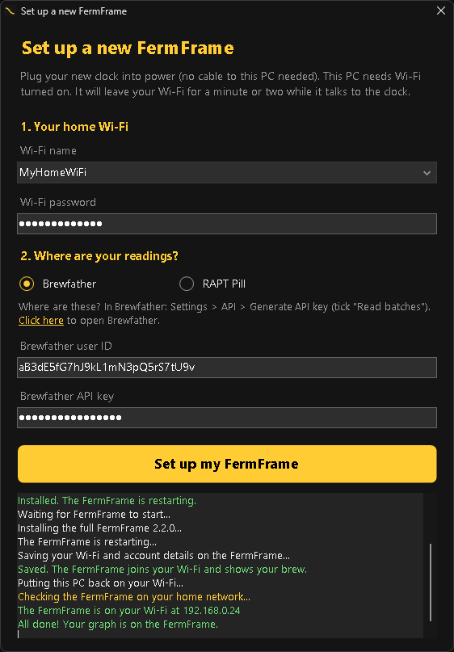

What happens, in order:

| Step | What you'll see | Notes |
|---|---|---|
| Find the clock | *Looking for your clock...* | It looks for the clock's own Wi-Fi, then on your home network. |
| Connect to it | *Found a brand-new clock...* | **This PC leaves your Wi-Fi for a minute or two.** That's normal. |
| Install FermFrame | *Installing FermFrame...* (about 30 s) | A small setup version first, because a new clock only accepts small files. |
| Install the full version | *Installing the full FermFrame 2.2.0...* | |
| Save your details | *Saving your Wi-Fi and account details...* | The FermFrame restarts and joins your Wi-Fi. |
| Back to your Wi-Fi | *Putting this PC back on your Wi-Fi...* | |
| Check | *The FermFrame is on your Wi-Fi at 192.168.x.x* | |
| First readings | *All done! Your graph is on the FermFrame.* | |

6. Close the window. The new FermFrame is in your list, named **FermFrame 1**, **FermFrame 2** and so on.
   [Rename it](#renaming-and-removing) to something like *Garage fridge*.

**If Windows asks about Location:** Windows only lets apps see nearby Wi-Fi networks when Location is on.
The app opens the right settings page: turn on **Location services** and **Let desktop apps access your location**,
then click **Set up my FermFrame** again.

**If something goes wrong,** the box says what to try. Most problems are fixed by unplugging the clock, waiting
5 seconds, plugging it back in, waiting 30 seconds and clicking **Set up my FermFrame** again. See
[Troubleshooting](#13-troubleshooting).

**Setting up a clock that already has FermFrame** (for example after changing your router): the app finds it and
asks whether to update its settings. You can also do this on the [Settings tab](#9-settings).

---

## 7. The main window

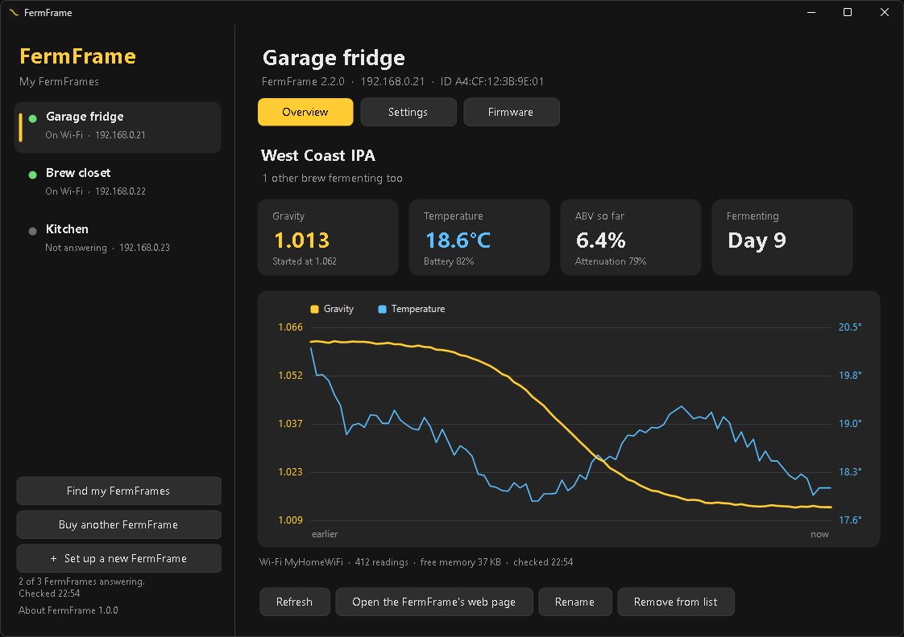

### The list (left)

Every FermFrame the app knows about, with a coloured dot:

| Dot | Meaning |
|---|---|
| 🟢 Green | On your Wi-Fi and working |
| 🔴 Red | Answering, but it has a problem (the problem is shown under its name) |
| ⚪ Grey | Not answering – unplugged, out of Wi-Fi range or restarting |

Under each name is its address on your network (for example `192.168.0.21`).

Below the list:

- **Find my FermFrames** – looks for FermFrames on your Wi-Fi and adds any new ones. Use it after setting one up
  on another PC, or if one has moved to a new address. The app also checks every minute by itself.
- **Buy another FermFrame** – see [section 3](#3-getting-a-clock).
- **+ Set up a new FermFrame** – see [section 6](#6-setting-up-a-new-fermframe).
- The status line says how many FermFrames are answering and when they were last checked.
- **About FermFrame** – version, licence and the software FermFrame is built with.

### The Overview tab

At the top: the FermFrame's name, its firmware version, address and ID (a code that's different for every clock).

| Part | What it shows |
|---|---|
| **Brew name** | The batch (Brewfather) or pill (RAPT) being shown, and how many other brews are fermenting |
| **Gravity** | The latest specific gravity, and the original gravity it started at |
| **Temperature** | The latest temperature (°C or °F – see [Settings](#6-more)), and the hydrometer's battery if it reports one |
| **ABV so far** | Alcohol by volume, worked out as (OG − gravity) × 131.25, and the **attenuation** (how much of the sugar has been used) |
| **Fermenting** | Days since the batch started fermenting – or **Ready to keg?** in green when gravity hasn't moved for 3 days |
| **Graph** | Gravity (amber, left scale) and temperature (blue, right scale) over the time range you chose in Settings |
| **Details line** | The Wi-Fi it's on, how many readings it has, free memory and when it was last checked |

### Buttons

- **Refresh** – checks all FermFrames now.
- **Open the FermFrame's web page** – opens the FermFrame's own settings page in your browser
  ([section 12](#12-the-fermframes-own-settings-page)).
- **Rename** – gives it a friendlier name (only on this PC).
- **Remove from list** – removes it from this PC's list. Nothing changes on the FermFrame, and if it's still on
  your Wi-Fi, **Find my FermFrames** adds it back.

---

## 8. Looking after several FermFrames

Click a FermFrame in the list to see it. Each one can show a different brew, and each has its own settings.

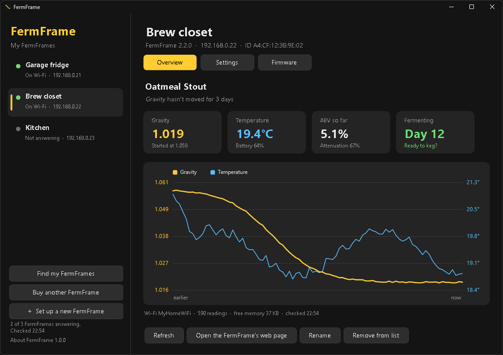

Here *Brew closet* shows **Ready to keg?** – its gravity has stayed the same for three days.

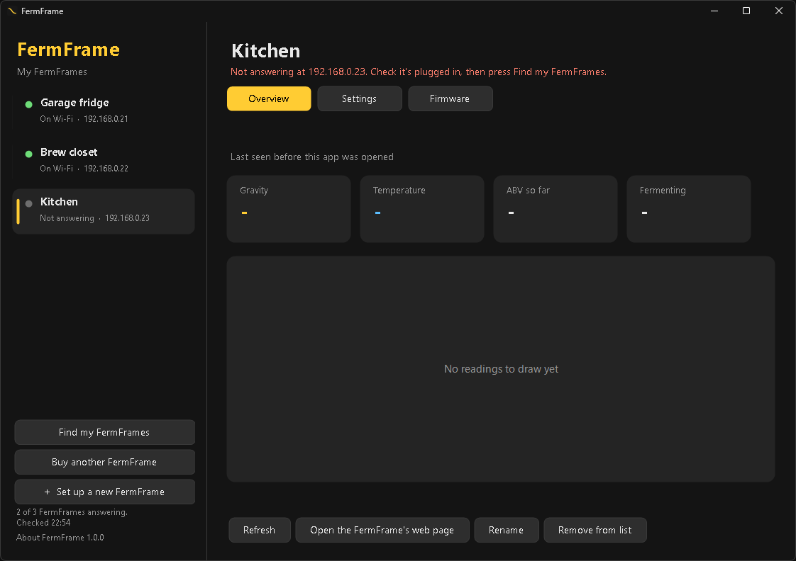

*Kitchen* has a grey dot and *Not answering*. Check it's plugged in. If it shows **Can't find Wi-Fi** on its screen, see
[Troubleshooting](#13-troubleshooting).

### Renaming and removing

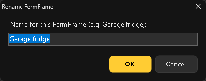

Click **Rename**, type a name and click **OK**. Names are kept on this PC only – another PC sees *FermFrame 1*,
*FermFrame 2* and so on until you rename them there too.

---

## 9. Settings

The **Settings** tab changes everything about the selected FermFrame. It reads the current settings from the
FermFrame when you open it. Nothing changes until you click **Save to FermFrame**.

- **Save to FermFrame** sends your changes. The FermFrame updates straight away and only **restarts if you changed
  the Wi-Fi**.
- **Undo my changes** reads the settings from the FermFrame again.

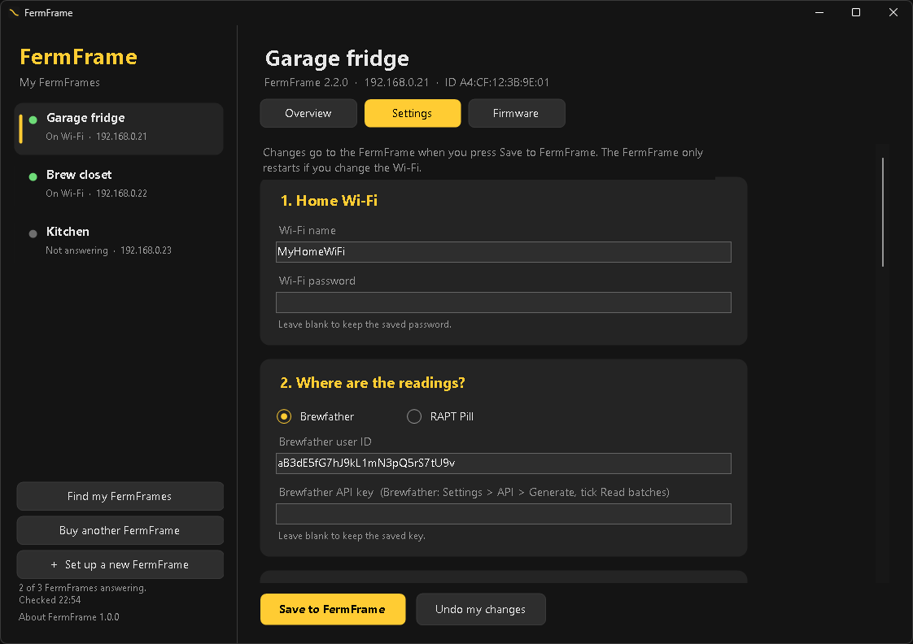

### 1. Home Wi-Fi

| Setting | Notes |
|---|---|
| **Wi-Fi name** | The network the FermFrame joins. Must be 2.4 GHz. |
| **Wi-Fi password** | Leave blank to keep the saved password. |

> ⚠️ If you change the Wi-Fi to a wrong name or password, the FermFrame can't get back onto your network and the app
> can't reach it. The app asks you to confirm first. To fix it, scan the QR code on the FermFrame's screen with your
> phone – see [section 11](#11-what-the-fermframe-shows).

### 2. Where are the readings?

| Setting | Notes |
|---|---|
| **Brewfather** / **RAPT Pill** | Where the readings come from |
| **Brewfather user ID** / **RAPT email** | |
| **Brewfather API key** / **RAPT API secret** | Leave blank to keep the saved key. Keys are never shown, not even here. |

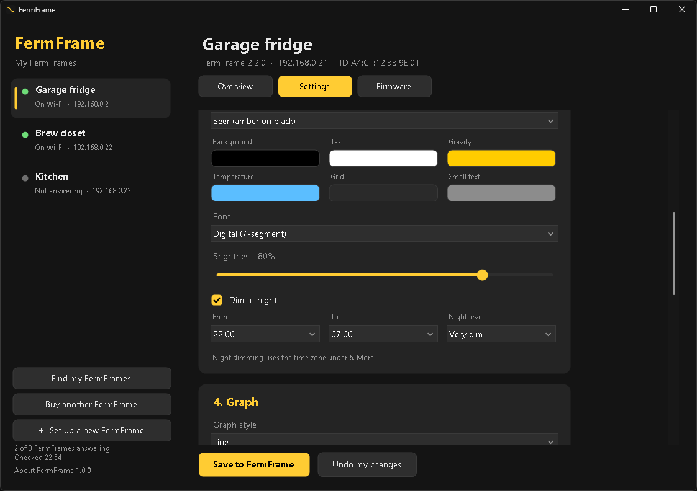

### 3. Look & feel

| Setting | Choices | What it does |
|---|---|---|
| **Theme** | Beer (amber on black), Dark, Light, Retro green, High contrast, My own colours | Picks a set of colours for the screen |
| **Colours** | Background, Text, Gravity, Temperature, Grid, Small text | Click a colour to choose your own. Changing one switches the theme to *My own colours*. |
| **Font** | Digital (7-segment), Modern, Classic, Typewriter | The style of the big numbers |
| **Brightness** | 5–100 % | Drag the slider |
| **Dim at night** | From / To / Night level (Off, Very dim, Dim, Medium) | Dims or switches off the screen at night. Uses the **time zone** in *6. More*. |

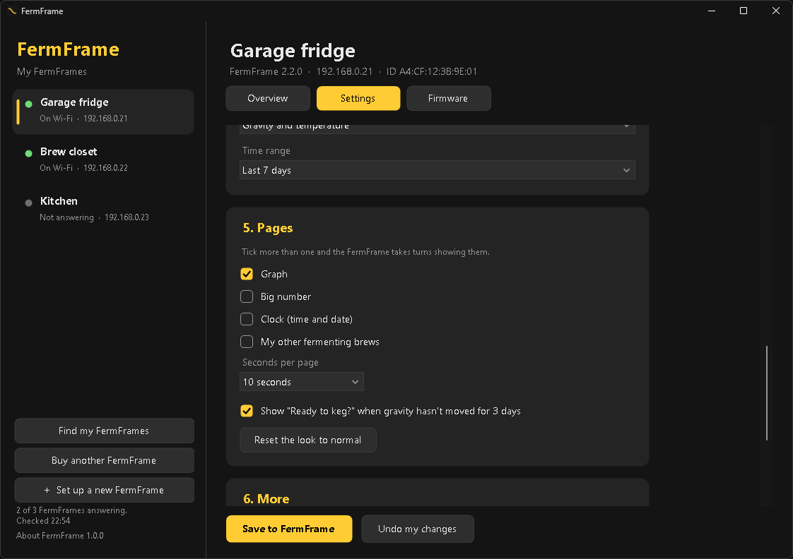

### 4. Graph

| Setting | Choices |
|---|---|
| **Graph style** | Line, Filled area, Dots, Daily bars |
| **Show** | Gravity and temperature, Gravity only, Temperature only |
| **Time range** | Last 24 hours, 3 days, 7 days, 14 days, Whole batch |

### 5. Pages

Tick more than one page and the FermFrame takes turns showing them.

| Page | What it shows |
|---|---|
| **Graph** | Gravity, temperature, ABV and the graph (the main page) |
| **Big number** | The gravity in large digits – readable across a room – with temperature and the day |
| **Clock (time and date)** | The time and date (uses the time zone) |
| **My other fermenting brews** | One page per other Fermenting batch, so one FermFrame can show several brews |

| Setting | Notes |
|---|---|
| **Seconds per page** | How long each page stays up, from 5 seconds to 10 minutes |
| **Show "Ready to keg?"** | Shows *Ready to keg?* when the gravity has changed by no more than 0.001 in 3 days |
| **Reset the look to normal** | Puts sections 3–5 back to the standard look (press Save to keep it) |

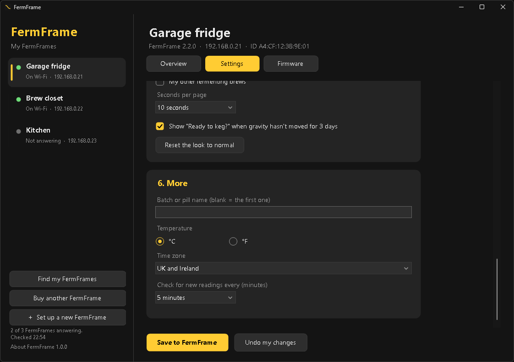

### 6. More

| Setting | Notes |
|---|---|
| **Batch or pill name** | Leave blank to show the first Fermenting batch (or the first pill). Type a batch or pill name to always show that one – useful when each FermFrame sits by a different fermenter. |
| **Temperature** | °C or °F |
| **Time zone** | For the clock page and night dimming |
| **Check for new readings every** | 1 minute to 2 hours (5 minutes is plenty – hydrometers usually report every 15 minutes) |

When you save, the status next to the buttons says what happened:

---

## 10. Firmware updates

The **Firmware** tab shows the version on the FermFrame and the version built into the app.

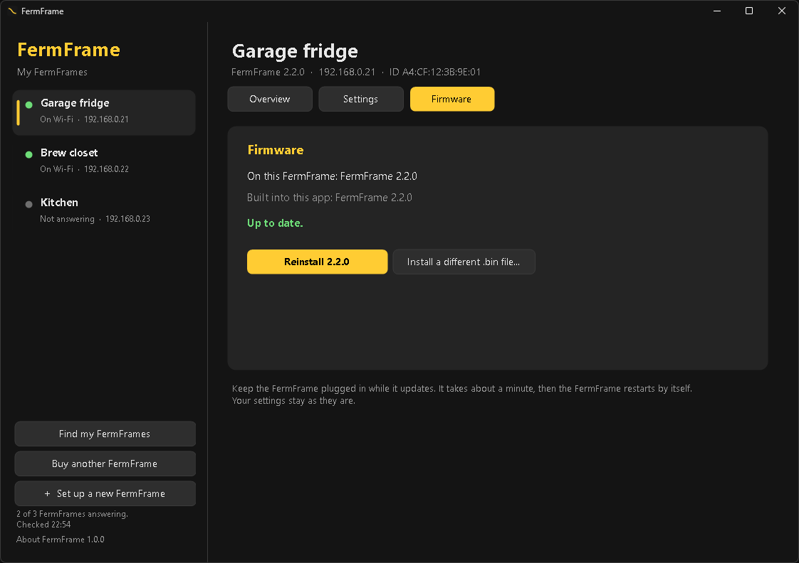

- **Update this FermFrame** appears when the FermFrame has an older version. Click it and wait about a minute. The
  FermFrame restarts by itself and **keeps all its settings**.
- **Update all N FermFrames** appears when more than one needs updating.
- **Reinstall** puts the same version on again – only needed if something seems wrong.
- Keep the FermFrame **plugged in** while it updates.

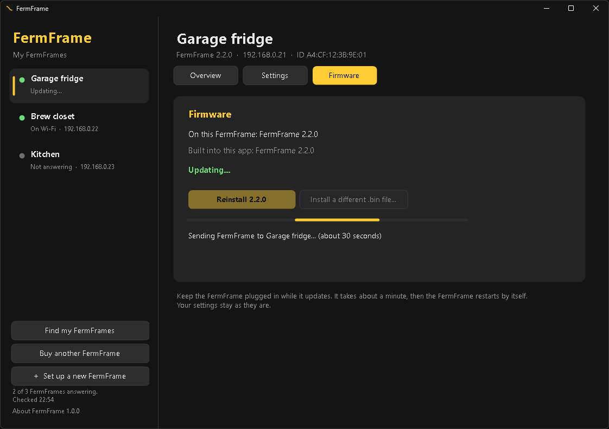

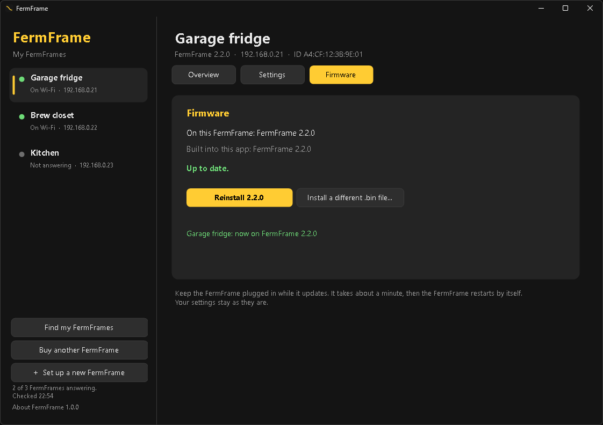

**Install a different .bin file...** is for advanced users (for example a test version). The app checks the file first:

- files for a **different chip**, files that aren't firmware and files that are too big are **refused**
- firmware that isn't FermFrame, the setup-only version and older versions get a **warning** first

New firmware versions come with new versions of the app – see [Updating the app](#16-updating-and-removing-the-app).

---

## 11. What the FermFrame shows

### When everything is working

The pages you picked in [Settings → Pages](#5-pages), in your theme.

### Messages

| Screen | Meaning | What to do |
|---|---|---|
| **Set me up!** + QR code | No Wi-Fi saved yet | Use **Set up a new FermFrame** in the app, or scan the QR code with your phone: it joins the FermFrame's own Wi-Fi (*FermFrame-Setup*) and the setup page opens. |
| **Can't find Wi-Fi** + QR code | Its saved Wi-Fi isn't there (router off, power cut, wrong name or password) | Wait – after a power cut it keeps retrying (it restarts every 3 minutes until the router is back). If the Wi-Fi name or password changed, scan the QR code with your phone and fix them. |
| **Almost there!** + QR code | On Wi-Fi, but no Brewfather/RAPT details | Add them in the app's Settings tab, or scan the QR code. |
| **Connecting to Wi-Fi**, **Getting the time...**, **Asking Brewfather...** | Starting up | Wait a few seconds. |
| A problem in red | Something's wrong – see below | |

### Problems it can show

| Problem | What to do |
|---|---|
| *Brewfather: wrong ID or API key* | Check the User ID and key (Settings tab). Make sure the key has **Read batches**. If you made a new key in Brewfather, put it on every FermFrame. |
| *No Fermenting batch in Brewfather* | Set your batch's status to **Fermenting** in Brewfather. |
| *No batch called '…'* / *No pill called '…'* | The name in **Settings → More → Batch or pill name** doesn't match. Fix it or clear it. |
| *RAPT: wrong email or API secret* | Use your RAPT email and an **API secret**, not your password. |
| *No RAPT Pill on this account* | Check the pill shows up in the RAPT app. |
| *Can't reach the internet* | Check your router. It tries again every minute. |
| *Waiting for internet time* | It needs the time from the internet; check your router. |
| *Wi-Fi dropped – reconnecting* | It reconnects by itself. |

If a problem appears after readings were already showing, the last good graph stays on screen with the problem in
red underneath.

---

## 12. The FermFrame's own settings page

Every FermFrame also has its own settings page, so you can change it from a phone or a Mac:

- click **Open the FermFrame's web page** in the app, or
- type its address (for example `http://192.168.0.21`) into a browser on your home Wi-Fi, or
- scan the QR code on its screen when it shows one.

The page has the same settings as the app's Settings tab, with a live preview of the screen. Saved passwords and
keys are never shown on it.

> If you have only one FermFrame you can also use **http://fermframe.local**. With several, that name may open any
> of them, so use the address instead.

---

## 13. Troubleshooting

| Problem | Try this |
|---|---|
| **Setup can't find the clock** | Unplug the clock, wait 5 seconds, plug it back in, wait 30 seconds, then click **Set up my FermFrame** again. Keep it near the PC. |
| **"Windows needs Location turned on"** | Settings → Privacy & security → Location: turn on **Location services** and **Let desktop apps access your location**. Windows needs this to list Wi-Fi networks. |
| **"…looks like 5 GHz only"** | The clock needs 2.4 GHz. Many routers have both under one name and that's fine; if yours has separate names, pick the 2.4 GHz one. |
| **The PC didn't come back to its Wi-Fi after setup** | Pick your Wi-Fi from the Wi-Fi menu in the taskbar. |
| **"The full version didn't install"** | Keep the clock close to the PC and click **Set up my FermFrame** again – it carries on where it stopped. |
| **A FermFrame shows a grey dot** | Check it's plugged in and in Wi-Fi range, then click **Find my FermFrames**. |
| **The FermFrame shows "Can't find Wi-Fi"** | See [section 11](#messages). |
| **No brew is showing** | Set the batch to **Fermenting** in Brewfather; check **Batch or pill name** is blank or correct. |
| **Numbers don't update** | Readings come from Brewfather/RAPT, so check your hydrometer is sending readings there. FermFrame asks every 5 minutes by default. |
| **The app says it can't read the settings** | The FermFrame may be busy restarting – wait a minute and click **Undo my changes** to try again. |
| **"Windows protected your PC" when opening the download** | Click **More info → Run anyway** (the app isn't signed by a company). |
| **Firmware update says "didn't come back yet"** | Wait a minute. If it still doesn't answer, unplug it and plug it back in – it keeps its settings. |

---

## 14. Questions and answers

**Can several FermFrames show the same brew?** Yes. Or give each one a different **Batch or pill name** so each shows
the fermenter it sits next to.

**Can one FermFrame show several brews?** Yes – tick **My other fermenting brews** in **Settings → Pages**.

**Do I need to keep the PC or app running?** No. FermFrames work on their own. The app is only for setting up,
viewing and changing them.

**Can I use FermFrames on a different Wi-Fi (moving house, new router)?** Before you switch, change the Wi-Fi on the
Settings tab. If it's too late, the FermFrame shows **Can't find Wi-Fi** – scan its QR code with your phone and enter
the new Wi-Fi there, or run **Set up a new FermFrame** again.

**Does it work with iSpindel, Tilt or other hydrometers?** Yes, if they send their readings to **Brewfather** – the
FermFrame reads Brewfather, not the hydrometer itself.

**Can I set FermFrames up from two PCs?** Yes. Each PC keeps its own list and names; use **Find my FermFrames** to add
existing ones.

**What if I want my clock back as a weather clock?** FermFrame replaces the clock's original software, and there's no
one-click way back. GeekMagic publishes its firmware online; experienced users can install it with
**Install a different .bin file...** on the Firmware tab, entirely at their own risk – after that, the app can no longer
see or update that clock.

**Is it safe to unplug a FermFrame?** Yes, at any time – except during a firmware update.

---

## 15. Privacy and security

- The **app** talks only to FermFrames on your home network, fetches the shop list from the FermFrame project on
  GitHub and, once a day, asks GitHub whether there's a new version (switch it off in **About**). It doesn't collect,
  send or share anything about you.
- Each **FermFrame** stores your Wi-Fi password and Brewfather/RAPT key on itself and contacts only Brewfather or
  RAPT (for readings) and internet time servers (for the clock).
- The connection to Brewfather and RAPT is encrypted, but the FermFrame doesn't check certificates (it hasn't enough
  memory). Anyone on your home network can open a FermFrame's settings page; saved passwords and keys are never shown
  on it.
- The app keeps your FermFrame names in `%APPDATA%\FermFrame`.

---

## 16. Updating and removing the app

**Updating:** from version 1.0.1 the app checks for a new version once a day. When there is one, a bar appears at the top of
the window: click **Update now**. It downloads the new version from the project page, checks it's exactly the published file,
installs it and reopens – your FermFrames and their names are kept. **What's new** shows the release notes; **Later**
hides the bar until you next open the app. In **About** you can switch the daily check off or click **Check now**.

If you have version 1.0.0, download the latest `FermFrame-<version>.exe` from the
[Releases page](https://github.com/ammcknockiter-cyber/FermFrame/releases/latest) once, open it and click **Update**.
If the new version has new firmware, the **Firmware** tab then offers to update your FermFrames.

**Removing:** Windows **Settings → Apps → Installed apps → FermFrame → Uninstall**. It asks whether to also forget
your FermFrame names. Your FermFrames keep working.

**About** (bottom left in the app) shows the app and firmware versions, the licence and the software FermFrame is
built with.

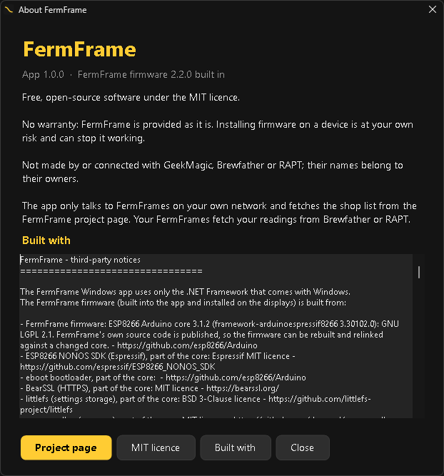

---

## 17. Getting help

Ask a question or report a problem on the project's
[Issues page](https://github.com/ammcknockiter-cyber/FermFrame/issues). Please include:

- the app version (bottom left) and the firmware version (Firmware tab)
- what the FermFrame's screen shows
- for setup problems, the messages in the setup window's box

FermFrame is free, open-source software under the MIT licence, provided without warranty. Installing firmware on a
device is at your own risk.
